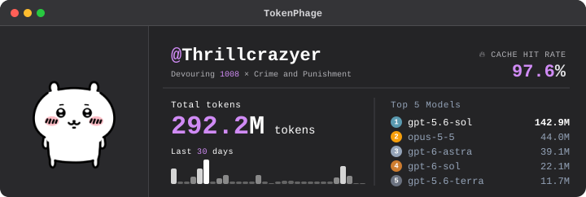

# TokenPhage Badge Proxy

Display the token usage you sync to TokenPhage in your GitHub profile README. This project fetches your badge as an SVG from the official TokenPhage API, then customizes its colors, typography, and layout and adds an animated Codex Pets character. The usage figures and model rankings come directly from TokenPhage. [Original TokenPhage badges](https://github.com/TOKENPHAGE/tokenphage-api)

## Preview

These examples were generated for `Thrillcrazyer`. Both feature the default character, Chiikawa by godxxy. [Chiikawa on Codex Pets](https://codex-pets.net/#/pets/chiikawa-svg)

**Usage card · `claude`**



**Annual activity heatmap · `grass-claude`**


## Add a badge to your GitHub profile

After the first GitHub Pages deployment, paste either line below into your profile `README.md`. These URLs show usage for `Thrillcrazyer`. GitHub Actions rebuilds both SVGs every six hours, so the same links show updated stats.

```markdown

```

```markdown

```

## Deploy badges for your own account

1. Sync your usage to TokenPhage under your GitHub username. TokenPhage uses that history to generate your badges. [TokenPhage CLI guide](https://github.com/TOKENPHAGE/tokenphage-cli)
2. Fork this repository and enable workflows in your fork’s **Actions** tab. Under **Settings → Pages → Build and deployment → Source**, select **GitHub Actions**.
3. In the workflow command `python build_pages.py Thrillcrazyer`, replace `Thrillcrazyer` with the GitHub username you synced. To use a different character, append its Codex Pets page URL with the `--pet` option, for example `--pet 'https://codex-pets.net/#/pets/umaru'`. Commit the change to `main`. [Deployment workflow](.github/workflows/badge.yml)
4. Once **Actions → Publish TokenPhage badge** finishes deploying, open your Pages site. Click the badge you want, copy its SVG URL, and use it in the corresponding Markdown example above.

Each push to `main` refreshes both badges. To refresh them manually, select **Actions → Publish TokenPhage badge → Run workflow**.

## Preview locally

```bash
python3 -m pip install -r requirements.txt
python3 build_pages.py Thrillcrazyer
python3 -m http.server 8000 --directory _site
```

Open the local site to preview both badges as they will appear on GitHub Pages. [Local preview](http://localhost:8000)

To try different usernames, characters, and themes, run `python3 server.py` and open the picker in your browser. [Local badge picker](http://localhost:8787)

You can also request a badge directly at a path such as `/badge/Thrillcrazyer?theme=grass-claude`. When passing a character URL in the `pet` query parameter, encode the `#` in that URL as `%23`.
